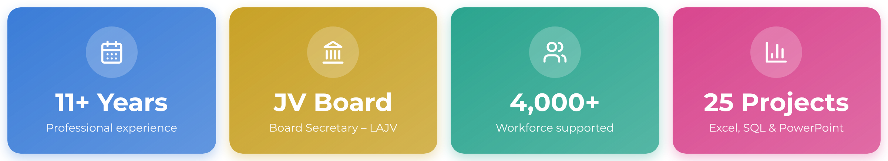
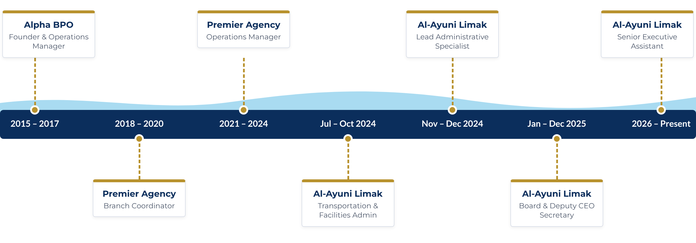

<div align="center">


<br>

[](https://sites.google.com/view/sudheer-ahmed)
[](https://www.linkedin.com/in/sudheer-ahmed-khattak)
[](mailto:khattaksudheer@gmail.com)
[](https://wa.me/923315701649)

<br>

> **Trusted right hand to senior leadership on Saudi giga-projects – keeping executive offices, boards and large-scale operations running with precision.**

</div>

---

## 👨‍💼 Executive Profile

I am a **Senior Executive Assistant** with **11+ years of professional experience** supporting executive leadership, project directors, boards and cross-functional teams across **Saudi Arabia and Pakistan**.

On a NEOM infrastructure project with **Al-Ayuni Limak (LAJV)** I have progressed through four roles – Transportation & Facilities Administrator, Lead Administrative Specialist in Logistics, **Secretary to the Joint Venture Board and the Deputy CEO**, and today **Senior Executive Assistant** to the Project Director and Project Senior Manager.

My background combines executive office support, board secretariat, PMO-style coordination, project administration, document control, procurement follow-up, executive reporting and the transport, facilities and camp services behind a **4,000+ strong workforce**.

This GitHub showcases the **dashboards, trackers, reporting systems and templates** I build to turn scattered information into clear, decision-ready reporting.

---

## 📈 At a Glance

<p align="center"></p>

---:|:---:|:---:|:---:|
| Professional experience | Board Secretary – LAJV | Workforce supported | Dashboards & trackers |

</div>

---

## 🧭 Career Journey

<p align="center"></p>

---

## 🎯 Career Focus

<div align="center">

**Senior Executive Assistant** • **Executive Secretary** • **Board Secretary**

**Project Administrator** • **PMO Support** • **Office Coordinator**

**Logistics Coordinator** • **Facilities Coordinator** • **Transportation & Fleet Coordinator**

**Business Support** • **Executive Reporting** • **Document Control**

</div>

---

## 💼 Core Expertise

| Executive & Project Support | Reporting & Operations |
|---|---|
| Executive Office Coordination | KPI Reporting & Dashboards |
| Board Secretariat & Governance | Power BI & SQL Reporting |
| Project Administration | Advanced Excel (VBA, Pivots) |
| PMO Support & Action Tracking | Executive Presentations |
| Minutes of Meeting & Correspondence | Procurement & Payment Tracking |
| Stakeholder Coordination | Fleet & Transportation Reporting |
| Document Control (Aconex) | Facilities & Camp Operations |
| VIP Hospitality & Events | Cost Control & Invoice Reconciliation |

---

## 🛠️ Systems & Tools

<p align="center">


</p>

---

## 📊 Featured Portfolio Projects

<p align="center"><i>Click any preview to open the project and its downloads.</i></p>

<table>
<tr>
<td width="50%" align="center" valign="top">
<a href="https://github.com/sudheer-ahmed-khattak/Excel-Trackers-and-Management-Reports/tree/main/Executive_Operations_Workforce_KPI_Dashboard"></a>
<br><b>01 · Executive Operations Workforce KPI Dashboard</b>
<br><sub>Attendance, overtime, workforce distribution and management KPIs.</sub>
</td>
<td width="50%" align="center" valign="top">
<a href="https://github.com/sudheer-ahmed-khattak/Excel-Trackers-and-Management-Reports/tree/main/Executive_Project_Operations_Control_Center"></a>
<br><b>02 · Executive Project Operations Control Center</b>
<br><sub>Project progress, priorities and operational KPIs for leadership.</sub>
</td>
</tr>
<tr>
<td width="50%" align="center" valign="top">
<a href="https://github.com/sudheer-ahmed-khattak/Excel-Trackers-and-Management-Reports/tree/main/Procurement_Payment_Control_Center"></a>
<br><b>03 · Procurement & Payment Control Center</b>
<br><sub>PRs, POs, invoices, approvals, vendors and payment progress.</sub>
</td>
<td width="50%" align="center" valign="top">
<a href="https://github.com/sudheer-ahmed-khattak/Excel-Trackers-and-Management-Reports/tree/main/Fleet_Equipment_Operations_Dashboard"></a>
<br><b>04 · Fleet & Equipment Operations Dashboard</b>
<br><sub>Equipment utilization, fleet availability and maintenance monitoring.</sub>
</td>
</tr>
<tr>
<td width="50%" align="center" valign="top">
<a href="https://github.com/sudheer-ahmed-khattak/Excel-Trackers-and-Management-Reports/tree/main/Fleet_Transportation_Executive_Brief"></a>
<br><b>05 · Fleet Transportation Executive Brief</b>
<br><sub>Vehicle utilization, fleet movement and trip performance.</sub>
</td>
<td width="50%" align="center" valign="top">
<a href="https://github.com/sudheer-ahmed-khattak/Excel-Trackers-and-Management-Reports/tree/main/Catering_Operations_Analytics_Dashboard"></a>
<br><b>06 · Catering Operations Analytics Dashboard</b>
<br><sub>Meal distribution, service performance and consumption trends.</sub>
</td>
</tr>
<tr>
<td width="50%" align="center" valign="top">
<a href="https://github.com/sudheer-ahmed-khattak/Excel-Trackers-and-Management-Reports/tree/main/Management_Action_Tracker"></a>
<br><b>07 · Management Action Tracker</b>
<br><sub>Actions, owners, priorities, deadlines and executive follow-up.</sub>
</td>
<td width="50%" align="center" valign="top">
<a href="https://github.com/sudheer-ahmed-khattak/Excel-Trackers-and-Management-Reports/tree/main/Document_Control_Correspondence_Command_Center"></a>
<br><b>08 · Document Control & Correspondence Command Center</b>
<br><sub>Correspondence, transmittals, approvals and document status.</sub>
</td>
</tr>
<tr>
<td width="50%" align="center" valign="top">
<a href="https://github.com/sudheer-ahmed-khattak/Excel-Trackers-and-Management-Reports/tree/main/Executive_Management_Presentation"></a>
<br><b>09 · Executive Management Presentation</b>
<br><sub>Board support, KPI communication and leadership updates.</sub>
</td>
<td width="50%" align="center" valign="top">
<a href="https://github.com/sudheer-ahmed-khattak/Excel-Trackers-and-Management-Reports/tree/main/Project_Organizational_Structure_Chart"></a>
<br><b>10 · Project Organizational Structure Chart</b>
<br><sub>Project hierarchy, reporting lines and governance structure.</sub>
</td>
</tr>
<tr>
<td width="50%" align="center" valign="top">
<a href="https://github.com/sudheer-ahmed-khattak/Excel-Trackers-and-Management-Reports/tree/main/Workforce_Release_Planning_EOS_Dashboard"></a>
<br><b>11 · Workforce Release Planning & EOS Dashboard</b>
<br><sub>Release planning, End-of-Service liabilities and workforce risk.</sub>
</td>
<td width="50%" align="center" valign="top">
<a href="https://github.com/sudheer-ahmed-khattak/Excel-Trackers-and-Management-Reports/tree/main/Executive_Water_Consumption_Analytics_Dashboard"></a>
<br><b>12 · Executive Water Consumption Analytics</b>
<br><sub>Water supply, contractors, fleet utilization and operating costs.</sub>
</td>
</tr>
<tr>
<td width="50%" align="center" valign="top">
<a href="https://github.com/sudheer-ahmed-khattak/Excel-Trackers-and-Management-Reports/tree/main/Rental_Workforce_Operations_Dashboard"></a>
<br><b>13 · Rental Workforce Operations Dashboard</b>
<br><sub>Active workforce, transfers, releases and headcount by location.</sub>
</td>
<td width="50%" align="center" valign="top">
<a href="https://github.com/sudheer-ahmed-khattak/Excel-Trackers-and-Management-Reports/tree/main/Friday_Workforce_Comparison_Dashboard"></a>
<br><b>14 · Friday Workforce Comparison Dashboard</b>
<br><sub>Week-on-week manpower additions, reductions and variance.</sub>
</td>
</tr>
<tr>
<td width="50%" align="center" valign="top">
<a href="https://github.com/sudheer-ahmed-khattak/Excel-Trackers-and-Management-Reports/tree/main/Executive_Business_Communication_Toolkit"></a>
<br><b>15 · Executive Business Communication Toolkit</b>
<br><sub>Executive correspondence, approvals and corporate email templates.</sub>
</td>
<td width="50%" align="center" valign="top">
<a href="https://github.com/sudheer-ahmed-khattak/Excel-Trackers-and-Management-Reports/tree/main/Workforce_Extension_Planning_Dashboard"></a>
<br><b>16 · Workforce Extension Planning Dashboard</b>
<br><sub>Extension requirements, release schedules and closeout planning.</sub>
</td>
</tr>
<tr>
<td width="50%" align="center" valign="top">
<a href="https://github.com/sudheer-ahmed-khattak/Excel-Trackers-and-Management-Reports/tree/main/Manpower_Release_Extension_Planner"></a>
<br><b>17 · Manpower Release & Extension Planner</b>
<br><sub>Search &amp; one-click UPDATE macro, release plan and sponsorship view.</sub>
</td>
<td width="50%" align="center" valign="top">
<a href="https://github.com/sudheer-ahmed-khattak/Excel-Trackers-and-Management-Reports/tree/main/WIR_Inspection_Tracker"></a>
<br><b>18 · WIR Inspection Tracker</b>
<br><sub>Daily inspection requests, status by discipline and overdue alerts.</sub>
</td>
</tr>
<tr>
<td width="50%" align="center" valign="top">
<a href="https://github.com/sudheer-ahmed-khattak/Excel-Trackers-and-Management-Reports/tree/main/Document_Control_Register"></a>
<br><b>19 · Document Control Register</b>
<br><sub>Review codes, instant document search and days-in-review tracking.</sub>
</td>
<td width="50%" align="center" valign="top">
<a href="https://github.com/sudheer-ahmed-khattak/Excel-Trackers-and-Management-Reports/tree/main/SQL_Project_Reporting"></a>
<br><b>20 · SQL Project Reporting</b>
<br><sub>Relational database and 20 SQL management report queries.</sub>
</td>
</tr>
<tr>
<td width="50%" align="center" valign="top">
<a href="https://github.com/sudheer-ahmed-khattak/Excel-Trackers-and-Management-Reports/tree/main/VIP_Visit_TBM_Ceremony_Plan"></a>
<br><b>21 · VIP Visit & TBM Breakthrough Ceremony Plan</b>
<br><sub>Run-of-show, guest protocol, security zones and convoy plan (PowerPoint).</sub>
</td>
<td width="50%" align="center" valign="top">
<a href="https://github.com/sudheer-ahmed-khattak/Excel-Trackers-and-Management-Reports/tree/main/Executive_Office_Approval_Workflows"></a>
<br><b>22 · Executive Office Approval Workflows</b>
<br><sub>PR/PO, IPC, contracts and letters via Oracle, DocuSign and Aconex (PowerPoint).</sub>
</td>
</tr>
<tr>
<td width="50%" align="center" valign="top">
<a href="https://github.com/sudheer-ahmed-khattak/Excel-Trackers-and-Management-Reports/tree/main/EA_Handover_Office_Playbook"></a>
<br><b>23 · EA Handover & Office Playbook</b>
<br><sub>Daily routine, meetings, filing, travel and handover sign-off (PowerPoint).</sub>
</td>
<td width="50%" align="center" valign="top">
<a href="https://github.com/sudheer-ahmed-khattak/Excel-Trackers-and-Management-Reports/tree/main/Board_Secretariat_Resolutions_Register"></a>
<br><b>24 · Board Secretariat & Resolutions Register</b>
<br><sub>Board meetings, resolutions, DocuSign signatures and action follow-up (Excel).</sub>
</td>
</tr>
<tr>
<td width="50%" align="center" valign="top">
<a href="https://github.com/sudheer-ahmed-khattak/Excel-Trackers-and-Management-Reports/tree/main/Visitor_Site_Access_SQL"></a>
<br><b>25 · Visitor & Site Access Management</b>
<br><sub>Inductions, HSE training, access cards and gate compliance (SQL).</sub>
</td>
<td width="50%" align="center" valign="middle">
<a href="https://github.com/sudheer-ahmed-khattak/Excel-Trackers-and-Management-Reports"></a>
<br><sub>Every project includes a preview, PDF and download files.</sub>
</td>
</tr>
</table>

<p align="center">
<a href="https://github.com/sudheer-ahmed-khattak/Excel-Trackers-and-Management-Reports"></a>
</p>

---

## 🏗️ Professional Experience Highlights

- Right hand to the **Project Director and Project Senior Manager** on a NEOM giga-project infrastructure package.
- **Secretary to the Joint Venture Board** – agendas, proceedings, formal board minutes and DocuSign sign-off.
- Steered high-value approvals – **PR/PO, contracts, IPCs, invoices and LCs** – through Oracle Fusion and DocuSign.
- Controlled **Aconex correspondence with NEOM**, briefing management on every letter with issues, actions and deadlines.
- Kept a **4,000+ strong workforce** moving and accommodated – fleet, drivers, camps, catering and facilities.
- Controlled costs at source – fuel, water and rental records reconciled against invoices before payment.
- Built KPI dashboards, manpower trackers and management reports in **Excel, Power BI and SQL**.
- Led a newly opened **pharmaceutical distribution branch** and founded a **US outbound call centre**.

---

## 🛡️ Portfolio Data Disclaimer

All dashboards, reports, financial figures, supplier information, employee records, procurement details, payment data, project documentation, KPIs, charts and operational datasets in this portfolio were created independently for demonstration only.

No original company, client, supplier, employee, finance, payroll, procurement, commercial or confidential project data has been copied, extracted, reproduced or used in any form. All names, organizations, values and scenarios are fictional, anonymized or recreated.

---

## 🌍 Let's Connect

<div align="center">

**Open to Executive Assistant, Board Secretary, PMO Support, Project Administration and Logistics & Facilities roles – worldwide.**

📧 [khattaksudheer@gmail.com](mailto:khattaksudheer@gmail.com) · 🌐 [Portfolio](https://sites.google.com/view/sudheer-ahmed) · 💼 [LinkedIn](https://www.linkedin.com/in/sudheer-ahmed-khattak)

```text
ORGANIZED • ANALYTICAL • PROACTIVE • DETAIL-ORIENTED • RESULTS-FOCUSED
```


</div>
